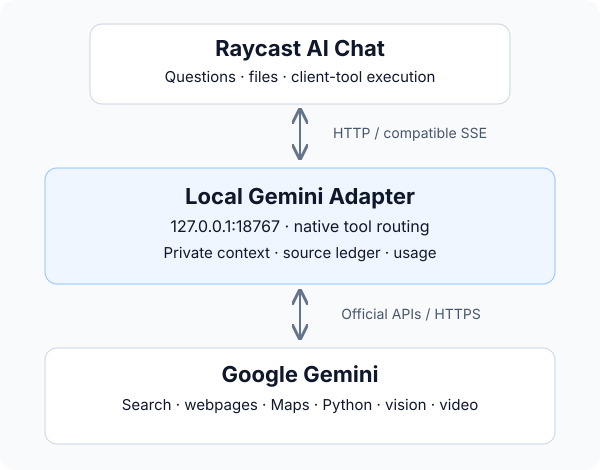

<div align="center">

<h1>Gemini Raycast Adapter</h1>
<p>Search, documents, video and follow-up questions in Raycast AI Chat.</p>
<p><strong>English</strong> · <a href="README.zh-CN.md">简体中文</a></p>
<p><a href="#quick-start">Quick start</a> · <a href="#usage">Usage</a> · <a href="#architecture">Architecture</a> · <a href="#configuration">Configuration</a> · <a href="#operations">Operations</a></p>
<sub>macOS · Python 3.11+ · Google Gemini API · MIT License</sub>

</div>

---

A local Python service connecting **Raycast Custom Providers** to Google's native Gemini APIs. Select a Gemini model in **Raycast AI Chat**, send a question, file path or video link, and continue discussing the results in the same conversation.

The adapter combines Google Search, webpage reading, Maps, visual file inputs and cloud Python with the tools supplied by Raycast. It preserves native tool context and source records when a tool returns control to Raycast or you ask a follow-up question.

> “Read the report in Downloads, explain Figure 2, and search for the source of its main claim.”
>
> “Summarize this video from 05:00 to 12:00, with approximate timestamps.”
>
> “Using the material already read, explain the second point and keep its citation.”

## Features

| Capability | What happens |
| --- | --- |
| **Search and webpages** | Google Search and URL Context run on Google's servers; successful reads and search hits have distinct source labels |
| **Maps** | A separate native Maps call returns place information and its map sources |
| **Images and documents** | Requested local images, PDF/Office files and text are read within configured directories and sent to Google; supported attachments retain their original bytes |
| **Cloud Python** | Google's code execution runs the calculation; document-based calculations use a separate call with the relevant data |
| **Video** | Public YouTube, HTTPS video-file URLs and local absolute paths use native video input; static processing supports ranges and timestamps |
| **Raycast tools** | The functions declared by Raycast remain available; Raycast executes them and sends the results back |
| **Follow-ups and citations** | Stored native context, stable source IDs and Google citation metadata survive tool handoffs; historical sources are labelled separately |
| **Usage** | Actual returned usage is summed across main and child calls, with dated token-cost estimates |

Supported model IDs: `gemini-4-carbon`, `gemini-4-neon`, `gemini-4-hydrogen`. Each has passed a native local-video API check. Neon received the broader mixed-tool, clipping and follow-up tests. Model switching preserves recoverable material while removing the previous model's signatures. See [validation](docs/VALIDATION.md) for the tested combinations and the distinction between API, offline and UI checks.

## Quick start

### 1. Prepare the checkout

You need macOS, Git, Python **3.11+**, a [Google AI Studio API key](https://aistudio.google.com/api-keys) with access and quota for the selected model, and Raycast Custom Providers. [Raycast 2 requires Pro or a higher plan for Bring Your Own AI](https://manual.raycast.com/ai/byoai); the original integration was tested with Raycast 1.

```sh
git clone https://github.com/Johnnyzlee/raycast-gemini-adapter.git
cd raycast-gemini-adapter
python3 --version  # 3.11 or newer
python3 -m venv .venv
./.venv/bin/pip install -r requirements.txt
cp settings.example.json settings.json
```

While this repository is private, clone with an account granted access, or use an owner-provided source archive. Keep the checkout in a permanent location: the login service uses its absolute path.

For **local video files**, install ffmpeg, which provides the `ffprobe` container inspector:

```sh
brew install ffmpeg
ffprobe -version
```

Search, documents, images and remotely hosted videos can be used without this local-video dependency.

### 2. Add the provider and choose file directories

Open `~/.config/raycast/ai/providers.yaml` locally. Merge the entry from [examples/providers.example.yaml](examples/providers.example.yaml) into its existing `providers` list and replace `YOUR_GOOGLE_API_KEY` with your key. Keep other providers. On Raycast 1, the Custom Providers switch is under Settings → AI → Experiments; consult Raycast's current settings for later versions.

The example uses `id: gemini`, three model names ending in `(Adapter)`, and the **official Google endpoint before installation**. The installer changes only this provider's endpoint. Display names are yours to choose. For an existing `gemini_li` entry, set `provider_id` to `gemini_li` in `settings.json` and retain its current model names.

Review `allowed_roots` in `settings.json`. Defaults are Desktop, Documents and Downloads. Add only directories containing files you want the adapter to read.

Already using DeepSeek? The [coexistence example](examples/providers.with-deepseek.example.yaml) shows Gemini beside an installed DeepSeek adapter on port `18766`. Merge the Gemini entry into your own file; retain your existing DeepSeek entry and key.

### 3. Install and verify

```sh
./.venv/bin/python manage.py install --dry-run
./.venv/bin/python manage.py install
./.venv/bin/python manage.py status
curl --fail http://127.0.0.1:18767/health
```

The dry run validates local configuration, model capabilities and the port without API calls. Installation creates a private provider backup, starts the login service, verifies health, then changes the Gemini endpoint to `http://127.0.0.1:18767`. Unrelated providers and keys stay intact.

Select **Gemini Neon (Adapter)** in AI Chat and enable the Raycast AI Extensions you use. Try “Run cloud Python to calculate 17 + 25.” A successful reply includes `42` and a successful Python tool marker. Restart Raycast if the model list has not refreshed.

## Usage

| Task | Example prompt |
| --- | --- |
| Search | “Search the Python website for the current release. Cite the actual sources.” |
| Webpage | “Read https://www.iana.org/help/example-domains and summarize its purpose.” |
| Image | “Read `/Users/YOUR_USER/Downloads/chart.png` and explain the axes.” |
| Document + calculation | “Read `/Users/YOUR_USER/Downloads/report.pdf`, then use cloud Python to verify the total in its table.” |
| Maps | “Use Google Maps to find the address of the Hong Kong Space Museum.” |
| Public video | “Analyze the first 8 seconds of https://storage.googleapis.com/cloud-samples-data/generative-ai/video/describe_video_content.mp4; describe the visible action and available sound.” |
| Local video | “Summarize `/Users/YOUR_USER/Downloads/demo.mp4`, with chapters and approximate timestamps.” |
| Video detail | “Look again at 05:00–05:20 in the same video, using high detail to explain the chart.” |
| Reuse context | “Use the material already analyzed to explain the second point. Cite it without rereading.” |

Replace `YOUR_USER` and file names with your own **absolute paths**. The model may ask Raycast's Finder tool to locate a file you explicitly name. Local file tools accept paths or names supplied by the user, rather than instructions embedded in webpages or files.

Video normally uses static processing: low resolution, 1 FPS, frames and audio. High detail uses high resolution and 2 FPS. A requested time range is sent as official processing offsets; local files are still uploaded in full. Explicitly requesting Agentic enables on-demand video navigation; this version uses static mode for time ranges. [Video and data details →](docs/DATA.md)

### How sources appear

Google's exact, uniquely matched support segments receive nearby citations. Other verified sources appear in a labelled list. Follow-ups select relevant historical source IDs instead of appending the whole chat's catalog. Files use their actual names; timestamps come from video analysis.

Tool markers distinguish success, failure and partial results. A Raycast result is marked as returned unless its payload contains an explicit error. Search suggestions remain available after handoffs: chat shows their links, and **“official original display”** opens Google's original HTML/CSS on a temporary local page. Raycast's Markdown view displays links rather than embedding that widget.

## Architecture



- **Raycast:** chat UI, enabled client-tool declarations, and execution of those client tools.
- **Adapter:** OpenAI-compatible HTTP/SSE, local file access, native-history recovery, tool dispatch, source storage and usage accounting.
- **Google:** model inference, Search, URL Context, Maps, cloud Python and native video analysis.

Ordinary chat uses `generateContent`. Maps and document-based Python use separate native calls; video uses the Interactions API, plus Files API uploads for local inputs. Every child call uses the selected model. Details of the source ledger and restore boundaries are in [ARCHITECTURE.md](docs/ARCHITECTURE.md).

## Configuration

Answers follow the requested language; adapter status, source and usage labels currently use Chinese.

Local `settings.json` is ignored by Git. Shared defaults are in [settings.example.json](settings.example.json).

| Setting | Default | Purpose |
| --- | --- | --- |
| `port` | `18767` | Loopback HTTP port |
| `provider_id` | `gemini` | Entry whose key is read and endpoint is installed |
| `providers_file` | `~/.config/raycast/ai/providers.yaml` | Credentials stay in this local file |
| `timezone` | `Asia/Hong_Kong` | Current-date context and estimate date |
| `allowed_roots` | Desktop, Documents, Downloads | Allowed resolved file directories |
| `state_dir` | `~/Library/Application Support/Gemini Raycast Adapter` | Private context, upload metadata and service logs |
| `service_label` | `local.gemini.raycast.adapter` | macOS login-service identity |
| `ffprobe` | `ffprobe` | Executable name or absolute path for local video inspection |
| `video_max_bytes` / `video_max_duration` | `268435456` / `10800` | Local-video caps: 256 MiB / 3 hours |
| `request_timeout_seconds` | `600` | Overall task deadline |
| `strict_file_authorization` | `true` | Require user-provided file paths or names |
| `show_usage_cost` | `true` | Append usage and token estimates |

The provider example keeps model IDs fixed and enables tools, vision and system messages. Changing a display name leaves API routing unchanged. Use `--settings /absolute/path/settings.json` with both `adapter.py` and `manage.py` for an isolated configuration. Installed paths, port and service identity should be changed through the migration procedure in [operations](docs/OPERATIONS.md).

## Operations

```sh
./.venv/bin/python manage.py status
./.venv/bin/python manage.py restart
./.venv/bin/python manage.py stop
./.venv/bin/python manage.py start

# Update an installed checkout
git pull --ff-only
./.venv/bin/pip install -r requirements.txt
./.venv/bin/python -m unittest -q
./.venv/bin/python manage.py restart

# Remove login startup and restore this provider to Google's direct endpoint
./.venv/bin/python manage.py rollback
```

`stop` unloads the current service; its saved login item remains. `rollback` / `uninstall` removes that login item and changes only the selected endpoint, preserving later unrelated provider edits. It keeps local state and backups. Video cleanup, history clearing, foreground startup, migration and code-version rollback are covered in [OPERATIONS.md](docs/OPERATIONS.md).

## Data, costs and limits

Requested messages, tool results, images, documents and video content go to **Google's official API**. File access is restricted to configured resolved paths. Local state contains conversation material and source metadata; its directory is private (`700`) and database is `600`.

History has a three-day inactivity window, at most 100 checkpoints and an approximately 256 MiB native-payload budget. Source events expire after three days, with at most 160 retained. Video upload references normally expire at Google after 48 hours and can be deleted earlier. [Retention and cleanup →](docs/DATA.md)

Token estimates aggregate main and child calls using the dated table in [COSTS.md](docs/COSTS.md). Missing cache information produces a range; tool charges and unavailable usage are labelled separately. Follow-ups send context again, and new video analysis incurs another model call. Upload reuse saves transfer work; inference remains billable.

| Boundary | Practical handling |
| --- | --- |
| Images/documents: 18 MiB; ordinary request: 64 MiB | Reduce or split the input |
| Local video: 256 MiB, 3 hours by default; direct URL: 15 MB | Use a local path for larger remote files; select a shorter analysis range |
| Maps + Python; PDF/Office + Python | Adapter separates incompatible native tool combinations |
| Private, login-required or restricted videos | Provide an accessible video or a local file you may upload |
| 8 internal rounds; 10-minute task deadline | Split longer tasks; occasional upstream timeouts return a readable SSE error |
| Chat identity | Credentials and transcript prefixes scope state; a supplied `conversation_id` adds isolation. Identical prefixes without that ID are indistinguishable |
| UI validation | HTTP/SSE and native API flows have been tested; Raycast's final rendering still needs local UI acceptance |

## Troubleshooting

| Symptom | Check and next step |
| --- | --- |
| Missing key / local 401 | Check `provider_id`, `api_keys`, model `provider` and `providers_file`; replace the placeholder locally |
| Google 403 / 429 | Check model access, API billing/quota and the Google error; retry after fixing the account condition |
| Connection refused | Run `manage.py status`; check the provider port and private `service.log`; start the installed service |
| Port occupied / another checkout owns service | Manage the existing installation from its own directory, or configure a distinct port and service label |
| Tool context expired | Start a new chat and reload the named material; changed/truncated histories can prevent recovery |
| File rejected | Use an absolute path or explicit name inside `allowed_roots`; check format/size and resolved symlink target |
| Local video inspection failed | Run `ffprobe -version`; set an absolute executable path if needed |
| Video URL failed | Use a public video-file URL rather than a player page; try a shorter range or permitted local file |
| “Failed to decode the response” | Verify `/health` reports version 2 and the provider points to this adapter; current error streams include the full completion envelope and readable cause |

## Development and license

```sh
# Offline regression suite: no key, uploads or paid requests
./.venv/bin/python -m unittest -q
./.venv/bin/python -m py_compile adapter.py configuration.py manage.py provenance.py video_tools.py usage_cost.py

# Optional, billable integration test; isolated database and ephemeral port
./.venv/bin/python scripts/generate_video.py
./.venv/bin/python test_video_live.py --settings settings.json --only video-hydrogen
```

The live runner limits local reads to generated `test-fixtures/`, cleans up its uploads, and keeps raw outputs in ignored `local-evidence/`. [Validation coverage](docs/VALIDATION.md) · [Contributing](CONTRIBUTING.md) · [Third-party notices](THIRD_PARTY_NOTICES.md)

[MIT License](LICENSE), following the companion [DeepSeek Raycast Adapter](https://github.com/Johnnyzlee/raycast-deepseek-adapter). Google and Raycast services follow their own terms.
