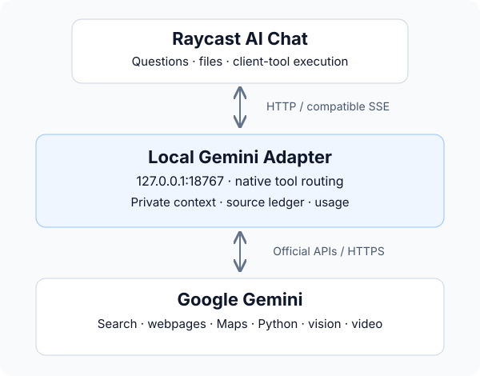

<div align="center">

<h1>Gemini Raycast Adapter</h1>
<p>在 Raycast AI Chat 中搜索、读文件、分析视频，并继续追问。</p>
<p><a href="README.md">English</a> · <strong>简体中文</strong></p>
<p><a href="#快速开始">快速开始</a> · <a href="#使用方法">使用方法</a> · <a href="#工作原理">工作原理</a> · <a href="#配置">配置</a> · <a href="#运行管理">运行管理</a></p>
<sub>macOS · Python 3.11+ · Google Gemini API · MIT License</sub>

</div>

---

这是一个连接 **Raycast 自定义模型与 Google Gemini 原生 API** 的本地 Python 服务。在 **Raycast AI Chat** 中选择 Gemini，发送问题、文件路径或视频链接，即可使用搜索、网页读取、Maps、图片与文档理解、云端 Python 和视频分析，并在同一聊天中继续追问。

适配器负责合并工具、读取指定文件、恢复原生上下文，并保存来源。Google 执行原生工具；Finder 等客户端工具仍由 Raycast 执行。

> “读取 Downloads 中的报告，解释图 2，再搜索主要结论的出处。”
>
> “总结这个视频的 05:00 到 12:00，按章节给出约略时间戳。”
>
> “沿用刚才读到的资料，解释第二个观点并引用来源。”

## 功能

| 能力 | 实际处理 |
| --- | --- |
| **搜索与网页** | Google Search 和 URL Context 在 Google 执行，分别记录搜索命中与实际读取成功的网页 |
| **Maps** | 单独调用原生 Maps，返回地点信息与对应地图来源 |
| **图片与文档** | 在允许目录内读取用户指定的图片、PDF、Office 和文本；保留受支持附件的原始内容 |
| **云端 Python** | 由 Google 执行计算；文档中的数据通过单独调用交给计算工具 |
| **视频** | 公开 YouTube、视频文件 HTTPS 直链和本地绝对路径采用原生视频输入，支持时间范围与时间戳问答 |
| **Raycast 工具** | 保留当前请求声明的函数，交回 Raycast 执行后继续回答 |
| **追问与来源** | 原生上下文、稳定来源标识和引用数据随工具交接保存；历史资料单独标注 |
| **用量** | 汇总主调用及子调用的实际返回用量，按注明日期的价格估算 token 费用 |

支持 `gemini-4-carbon`、`gemini-4-neon`、`gemini-4-hydrogen`。三个模型均通过本地视频原生输入测试；Neon 重点验证了混合工具、片段分析、追问和切换模型。切换模型时恢复可用资料，移除前一模型的签名。[测试范围与结果](docs/VALIDATION.md) 区分本地模拟、真实 API 与界面验收。

## 快速开始

### 1. 准备项目

需要 macOS、Git、Python **3.11+**、具有所选模型访问权限与额度的 [Google AI Studio API key](https://aistudio.google.com/api-keys)，以及 Raycast Custom Providers。[Raycast 2 的自带模型接入需要 Pro 或更高方案](https://manual.raycast.com/ai/byoai)；最初的接入环境为 Raycast 1。

```sh
git clone https://github.com/Johnnyzlee/raycast-gemini-adapter.git
cd raycast-gemini-adapter
python3 --version  # 至少 3.11
python3 -m venv .venv
./.venv/bin/pip install -r requirements.txt
cp settings.example.json settings.json
```

仓库处于私有状态期间，需要获授权的 GitHub 账号，或使用作者提供的源码压缩包。把项目放在长期保留的位置，登录服务会引用它的绝对路径。

使用**本地视频**时，安装提供 `ffprobe` 的 ffmpeg：

```sh
brew install ffmpeg
ffprobe -version
```

搜索、图文文件和远程视频入口可独立于这项本地视频依赖使用。

### 2. 配置 provider 和文件目录

在本机打开 `~/.config/raycast/ai/providers.yaml`，把 [providers.example.yaml](examples/providers.example.yaml) 中的条目合并到现有 `providers` 列表，将 `YOUR_GOOGLE_API_KEY` 换成自己的密钥，保留其他 provider。Raycast 1 的开关位于 Settings → AI → Experiments → Custom Providers；后续版本按其当前设置入口操作。

示例使用 `id: gemini`，三个显示名称分别为 `Gemini Carbon (Adapter)`、`Gemini Neon (Adapter)` 和 `Gemini Hydrogen (Adapter)`。**安装前保留示例中的 Google 官方地址**，安装器随后只修改选中 provider 的地址。

已有 `gemini_li` 配置时，在 `settings.json` 中设置 `"provider_id": "gemini_li"`，保留原有模型显示名称。模型 ID 用于 API 路由；显示名称可以自定。

检查 `allowed_roots`：默认允许 Desktop、Documents 和 Downloads。按需加入存放待分析文件的目录。

[与 DeepSeek 共存的示例](examples/providers.with-deepseek.example.yaml) 展示 Gemini 与已安装的 DeepSeek 适配器并列的结构。DeepSeek 默认使用 `18766`，Gemini 使用 `18767`；实际操作时保留自己的 DeepSeek 条目与密钥。

### 3. 安装并验证

```sh
./.venv/bin/python manage.py install --dry-run
./.venv/bin/python manage.py install
./.venv/bin/python manage.py status
curl --fail http://127.0.0.1:18767/health
```

预检检查配置、模型能力及端口，不调用 API。安装会备份 provider 文件、启动登录服务、检查健康状态，再把 Gemini 地址改为 `http://127.0.0.1:18767`。

在 AI Chat 选择 **Gemini Neon (Adapter)**，启用需要的 AI Extensions，提问“在云端 Python 实际计算 17 + 25”。成功回复应包含 `42` 和 Python 执行成功提示。模型列表尚未刷新时，重启 Raycast。

## 使用方法

| 场景 | 可以直接改写使用的提问 |
| --- | --- |
| 搜索 | “搜索 Python 官网当前版本，附实际来源。” |
| 网页 | “读取 https://www.iana.org/help/example-domains 并概括用途。” |
| 图片 | “读取 `/Users/YOUR_USER/Downloads/chart.png`，解释坐标轴与趋势。” |
| 文档与计算 | “读取 `/Users/YOUR_USER/Downloads/report.pdf`，用云端 Python 核对表格中的合计。” |
| 地图 | “用 Google Maps 查询香港太空馆的地址。” |
| 视频直链 | “分析 https://storage.googleapis.com/cloud-samples-data/generative-ai/video/describe_video_content.mp4 的前 8 秒，描述画面动作与可听声音。” |
| 本地视频 | “总结 `/Users/YOUR_USER/Downloads/demo.mp4`，给出章节及约略时间戳。” |
| 视频细节 | “重新查看同一视频 05:00 到 05:20，用高精度解释图表。” |
| 历史追问 | “沿用刚才已分析的内容解释第二个观点，引用原来源，不重新读取。” |

把 `YOUR_USER` 和文件名换成实际的**绝对路径**。明确给出文件名后，也可让当前启用的 Finder 工具定位。文件授权来自用户的消息；网页或文档中的指令不会授权额外文件读取。

普通视频采用 static：低分辨率、1 FPS、画面及音频输入。高精度改为高分辨率、2 FPS。指定区间会使用官方处理偏移参数；本地文件仍需完整上传。明确要求 Agentic 时使用按需导航；指定区间在本版本中采用 static。[视频细节与数据处理](docs/DATA.md)

### 来源如何显示

Google 返回的支持片段能与正文唯一精确匹配时，引用放在相邻位置；其他来源进入带类型的资料列表。追问使用稳定的来源标识，标为“沿用历史资料”。文件显示实际名称，视频时间戳来自分析结果。

“本次工具”区分成功、失败和部分成功；Raycast 返回值有明确错误字段时标失败，其余标为“已返回，未独立核验”。Google 搜索建议在交接后继续保留：聊天显示链接，点击“官方原始展示”可在本机页面查看原始 HTML/CSS。Raycast 的 Markdown 正文使用链接展示这一组件。

## 工作原理



- **Raycast**：聊天界面、当前启用的客户端函数及其执行结果。
- **适配器**：兼容 HTTP/SSE、读取指定文件、恢复上下文、分派工具、保存来源和统计用量。
- **Google**：推理、Search、URL Context、Maps、云端 Python 及原生视频理解。

普通对话使用 `generateContent`；Maps 与文档计算采用单独调用；视频使用 Interactions API，本地视频另通过 Files API 上传。子调用沿用当前选中的模型。[实现与恢复机制](docs/ARCHITECTURE.md)

## 配置

本地 `settings.json` 被 Git 忽略，共享默认值在 [settings.example.json](settings.example.json)。回答语言按提问决定；适配器的状态、来源及用量提示目前使用中文。

| 配置项 | 默认值 | 用途 |
| --- | --- | --- |
| `port` | `18767` | 仅监听本机回环接口 |
| `provider_id` | `gemini` | 读取密钥和安装时修改地址的条目 |
| `providers_file` | `~/.config/raycast/ai/providers.yaml` | 本地凭据文件 |
| `timezone` | `Asia/Hong_Kong` | 当前日期与估算日期 |
| `allowed_roots` | Desktop、Documents、Downloads | 允许读取的真实路径范围 |
| `state_dir` | `~/Library/Application Support/Gemini Raycast Adapter` | 私有上下文、上传元数据及日志 |
| `service_label` | `local.gemini.raycast.adapter` | 登录服务标识 |
| `ffprobe` | `ffprobe` | 程序名或绝对路径 |
| `video_max_bytes` / `video_max_duration` | `268435456` / `10800` | 本地视频默认 256 MiB / 3 小时 |
| `request_timeout_seconds` | `600` | 整体请求期限 |
| `strict_file_authorization` | `true` | 按用户给出的路径或文件名授权 |
| `show_usage_cost` | `true` | 追加用量及 token 估算 |

对 `adapter.py` 和 `manage.py` 均可使用 `--settings /absolute/path/settings.json` 指定独立配置。安装后的目录、端口和服务标识变更，按[迁移步骤](docs/OPERATIONS.md)处理。

## 运行管理

```sh
./.venv/bin/python manage.py status
./.venv/bin/python manage.py restart
./.venv/bin/python manage.py stop
./.venv/bin/python manage.py start

# 更新已安装的目录
git pull --ff-only
./.venv/bin/pip install -r requirements.txt
./.venv/bin/python -m unittest -q
./.venv/bin/python manage.py restart

# 恢复选中 provider 的 Google 直连地址并移除登录服务
./.venv/bin/python manage.py rollback
```

`stop` 卸载本次运行的服务，登录项文件仍保留；`rollback` / `uninstall` 移除登录项并恢复选中条目的地址，保留其他 provider、本地状态和备份。前台运行、上传清理、历史清理、迁移及代码版本回滚见 [OPERATIONS.md](docs/OPERATIONS.md)。

## 数据、费用与限制

请求中的消息、工具结果、图片、文档和视频会发送至 **Google 官方 API**。本地状态含聊天资料和来源，目录权限为 `700`，数据库为 `600`。

会话快照 3 天未更新后过期，最多 100 份，原生负载预算约 256 MiB；来源事件本身保留 3 天、最多 160 条。Google 视频上传通常 48 小时过期，可提前清理。[保留与清理说明](docs/DATA.md)

费用提示汇总实际返回的主调用和子调用用量，按 [COSTS.md](docs/COSTS.md) 的注明日期价格估算。缓存量缺失时显示区间；工具收费和缺失用量单独列为未知。追问会再次发送上下文，新片段分析会产生新的推理调用。

| 条件 | 影响与处理 |
| --- | --- |
| 图片/文档 18 MiB；普通请求 64 MiB | 缩小文件或拆分任务 |
| 本地视频默认 256 MiB、3 小时；直链 15 MB | 大型远程文件使用允许的本地副本，分析时指定片段 |
| Maps＋Python、PDF/Office＋Python 的原生组合限制 | 适配器分开调用后汇总结果 |
| 私人、登录或受限视频 | 使用公开可访问视频或有权上传的本地文件 |
| 每次最多 8 轮内部调用，总期限 10 分钟 | 拆分长任务；上游超时会返回可理解的错误 |
| 聊天身份 | 按凭据和聊天前缀绑定；有 `conversation_id` 时额外隔离，无此 ID 的完全相同前缀无法区分 |
| 界面验收 | 已验证 HTTP/SSE 与真实 API；Raycast 最终渲染仍需本地界面验收 |

## 排错

| 现象 | 检查方法 |
| --- | --- |
| 密钥缺失或本地 401 | 核对 `provider_id`、`api_keys`、模型 `provider` 和配置文件路径 |
| Google 403 / 429 | 按错误检查模型权限、API 计费及额度，处理后重试 |
| 连接被拒绝 | 检查 `manage.py status`、provider 端口和私有 `service.log` |
| 端口被占用或服务属于其他目录 | 到已安装目录管理服务，或设置独立端口及服务标识 |
| 工具上下文过期 | 开新聊天重新加载资料；截断或改写历史可能影响恢复 |
| 文件被拒绝 | 核对绝对路径、允许目录、大小、格式和符号链接的真实目标 |
| 视频容器检查失败 | 执行 `ffprobe -version`，必要时配置其绝对路径 |
| 视频 URL 失败 | 使用公开文件直链，缩短片段，或提供允许上传的本地文件 |
| 解码错误 | 检查 `/health` 为 version 2，provider 指向本适配器；新版错误流带完整响应结构与具体原因 |

## 开发与许可证

```sh
# 离线测试，不需要密钥，不调用付费 API
./.venv/bin/python -m unittest -q
./.venv/bin/python -m py_compile adapter.py configuration.py manage.py provenance.py video_tools.py usage_cost.py

# 可选真实测试，会产生 API 用量；使用临时数据库和随机端口
./.venv/bin/python scripts/generate_video.py
./.venv/bin/python test_video_live.py --settings settings.json --only video-hydrogen
```

真实测试只允许读取生成的 `test-fixtures/`，结束时清理自己的上传，原始响应写入被忽略的 `local-evidence/`。[验证记录](docs/VALIDATION.md) · [贡献说明](CONTRIBUTING.md) · [依赖与素材许可](THIRD_PARTY_NOTICES.md)

采用 [MIT License](LICENSE)，与配套的 [DeepSeek Raycast Adapter](https://github.com/Johnnyzlee/raycast-deepseek-adapter) 保持一致。Google 与 Raycast 服务遵循各自条款。
